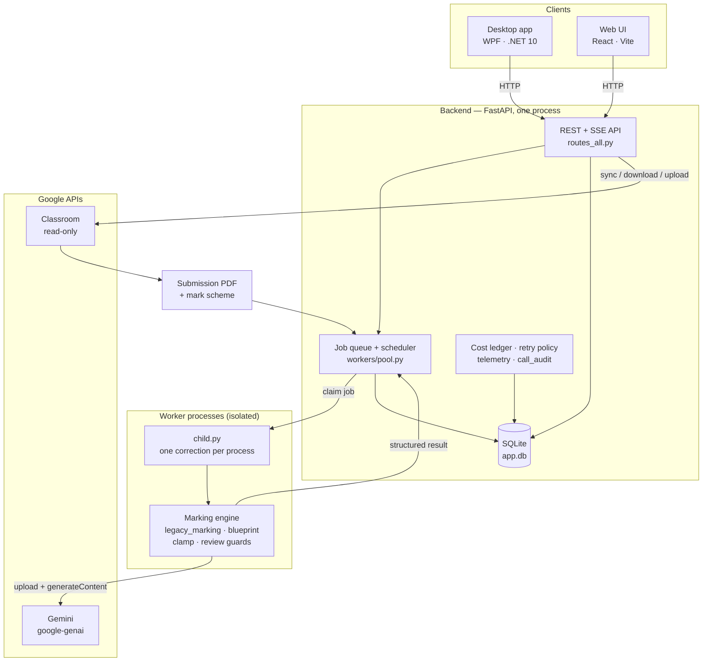

# Math Checker V5

**An AI-assisted marking application for Edexcel IGCSE Mathematics, built and used for real classroom work.**

A teacher uploads a student's scanned answers and the published mark scheme. The
application marks the paper question by question, explains every mark, flags what
it is unsure about, and puts a teacher in control of the result before anything
is shared with a student.

It exists because marking 120 handwritten papers a week is not a job anybody
should do twice. The design goal is not "an AI that marks" — it is **an
assessment tool a teacher can trust, audit and override**, which is a much
harder and more interesting engineering problem.

| | |
|---|---|
| **Backend** | Python 3.12+ (3.13 tested) · FastAPI · SQLite · Google Gemini |
| **Web UI** | React 18 · TypeScript 5.6 · Vite 5 (served by the backend) |
| **Desktop** | Windows WPF · .NET 10 (`net10.0-windows`) |
| **Backend tests** | 2 555 passing (1 skipped) — last full run 2026-10-30 |
| **Desktop tests** | 335 passing — last full run 2026-10-30 |
| **Marking model** | Gemini 3.6 Flash by default; the model chain is configuration |

---

## Contents

- [What it does](#what-it-does)
- [Features](#features)
- [Architecture](#architecture)
- [Technology stack](#technology-stack)
- [Project structure](#project-structure)
- [Getting started](#getting-started)
- [Testing and quality assurance](#testing-and-quality-assurance)
- [Performance engineering](#performance-engineering)
- [Privacy and security](#privacy-and-security)
- [Roadmap](#roadmap)
- [Screenshots](#screenshots)
- [Documentation](#documentation)

---

## What it does

1. **Ingest.** A submission arrives from Google Classroom, a local PDF, or a
   manual upload. The file is validated (a scan that is not a readable PDF is
   rejected before it costs an API call) and normalised.
2. **Mark.** The whole answer scan and the whole mark scheme go to Gemini in one
   multimodal request. The model returns structured JSON: every question, its
   available marks, the awarded marks, and feedback.
3. **Check.** The engine clamps every mark to the scheme's maximum, reconciles
   question numbering, and flags anything it could not map. A question it cannot
   find becomes **REVIEW**, never a silent zero.
4. **Review.** A teacher sees the paper as a marking desk: each question, the
   awarded and available marks, the model's reasoning, and the option to change
   any mark with a recorded reason.
5. **Report.** Assignment and class reports (PDF, Markdown, CSV) are produced
   from the stored result, not from a re-mark.

Everything runs locally. The only outbound traffic is to the Google APIs a
teacher configured (Gemini, optionally Classroom).

## Features

Only implemented and verified behaviour is listed. Anything incomplete is in
[what is not finished](#what-is-not-finished).

**Marking engine**
- Whole-paper multimodal marking against a mark scheme, with a fixed response
  schema so a malformed reply is a detectable error rather than a parse crash.
- Deterministic sampling (`temperature 0`, fixed seed) so the same paper and
  scheme produce the same marks as far as the provider allows.
- Per-question mark clamping, totals, percentage bands and grade bands.
- Mark-scheme analysis: question inventory, subquestion mapping, and a review
  surface for scheme text the app could not parse with confidence.
- "Missing question → REVIEW" is enforced structurally, not by prompt wording.
- Optional second-opinion pass for high-scoring papers.

**Teacher workflow**
- Marking desk with per-question review, mark editing and recorded overrides.
- Re-mark and remark requests with their own audit trail.
- Assignment management, classes, students, and per-student result history.
- Reports generated from stored results (no re-marking), exportable to PDF,
  Markdown and CSV.
- Review reasons surfaced to the teacher: why a question is flagged.

**Classroom and operations**
- Google Classroom read-only integration: list courses and coursework, download
  submissions, upload reports. Grade write-back is limited by Google's OAuth
  policy and is offered as suggested grades (see [roadmap](#roadmap)).
- A worker pool that runs each correction in its own OS process, with a durable
  queue, crash recovery on boot, and duplicate-correction prevention.
- Retry policy with explicit failure classes: retry, park for capacity, or fail
  fast. Parks do not consume the retry budget.
- Per-request cost ledger and a Usage page: requests, tokens, retries, key
  cooldowns, and how much was avoided by reusing prepared input.
- API key management with rotation, per-key health and staged key testing.
- Offline demo mode (mock marking) so the UI can be explored without a key.

**What is not finished**
- **Teacher-certified accuracy does not exist yet.** 0 of 16 reference items have
  been verified by a teacher; every accuracy figure in this repository is
  agreement with a scheme-derived answer key. See
  [results/TEACHER_CERTIFIED_ACCURACY_REPORT.md](docs/results/TEACHER_CERTIFIED_ACCURACY_REPORT.md).
- **Grade write-back to Classroom** is constrained by Google (an OAuth app may
  only grade coursework it created), so V5 shows suggested grades for manual
  entry.
- **Page batching for very long papers** exists as a planner
  (`backend/app/engine/batching.py`) with no execution path; it is not enabled.
- **Multi-machine sync agent** exists in source but is disabled by default and
  should be treated as experimental.

## Architecture



**Why a child process per correction.** The marking engine came from a working
single-user script with module-level state. Running each correction in its own
OS process means one paper cannot corrupt another, a crash cannot take down the
scheduler, and a wedged request can be terminated at the OS level. The parent
talks to it over stdin/stdout JSON — no shared globals, no pickling of live
objects.

**Correction pipeline**

```
QUEUED → STARTING → PREPARING → DOWNLOADING → UPLOADING → MARKING → VERIFYING → SAVING → COMPLETED
```

- A job claim is a single SQL transaction, so the same job cannot run twice.
- Retries reuse the prepared input (no second download, normalisation or
  mark-scheme fetch).
- A retry is only scheduled after the previous attempt's process has exited.
- Terminal failures keep their evidence (stage history, prepared files) so a
  teacher can see what happened before deciding to retry.

More detail: [docs/architecture/ARCHITECTURE.md](docs/architecture/ARCHITECTURE.md)
and [docs/architecture/PROJECT_STRUCTURE.md](docs/architecture/PROJECT_STRUCTURE.md).

## Technology stack

| Layer | Choice | Notes |
|---|---|---|
| Language (backend) | Python 3.12+ (3.13.15 tested) | No compiled extensions written in this project |
| Web framework | FastAPI ≥ 0.115, Uvicorn ≥ 0.30 | REST + Server-Sent Events for live job progress |
| Persistence | SQLite (stdlib `sqlite3`) | WAL mode, schema migrations in `backend/app/schema.sql` |
| AI provider | `google-genai` ≥ 1.40 → Gemini 3.6 Flash | Model chain configurable; one provider on purpose |
| PDF | PyMuPDF 1.x (`<2`), pypdf ≥ 4, Pillow ≥ 10 | Validate, inspect, normalise, render |
| Reporting | openpyxl ≥ 3.1, reportlab ≥ 4 | XLSX + PDF exports |
| Auth / Classroom | `google-auth`, `google-auth-oauthlib` ≥ 1.2 | OAuth client supplied by the deployment |
| Frontend | React 18.3, TypeScript 5.6, Vite 5.4 | Built into `frontend/dist`, served by the backend |
| Desktop | WPF, `net10.0-windows`, no third-party packages | MVVM, native window and installer |
| Tests | pytest ≥ 8, httpx ≥ 0.27, xUnit | 2 555 backend + 335 desktop tests |

## Project structure

```
.
├── backend/
│   ├── app/
│   │   ├── api/            REST + SSE routes, benchmark routes
│   │   ├── engine/         marking engine, blueprint, scheme analysis, guards
│   │   ├── gemini/         client proxy, key manager, telemetry, call audit
│   │   ├── workers/        pool, process adapter, child entry point
│   │   ├── jobs/           queue manager, recovery, stage events
│   │   ├── classroom/      OAuth, sync, submissions, report upload
│   │   ├── benchmark/      reproducible benchmark harness
│   │   ├── distributed/    multi-machine agent (disabled by default)
│   │   ├── config.py       configuration + secret store
│   │   └── schema.sql      database schema
│   ├── tests/              pytest suite (2 555 tests)
│   └── scripts/            verification + benchmark scripts
├── desktop/                WPF client: src/, tests/, installer/, build_release.ps1
├── frontend/               React + TypeScript UI (src/, scripts/)
├── docs/
│   ├── architecture/       how it is built, how the repo is laid out
│   ├── development/        setup, environments, distribution mode
│   ├── guides/             feature-level explanations
│   ├── performance/        quota, retry and compression behaviour
│   ├── testing/            test strategy and subsystem audits
│   ├── release/            building and shipping the package
│   ├── reports/            dated audit and delivery reports
│   └── results/            machine-readable verification output
├── scripts/                repository tooling (portable build, link check, E2E)
├── MathChecker_Distribution/  portable Windows packaging workspace
├── main.py                 single entry point for the backend
├── setup.bat / start.bat   Windows setup and launch
└── start.sh                Linux / macOS launcher
```

`data/` (database, secrets, logs, student PDFs) is created on first run and is
never committed.

## Getting started

### Prerequisites

- **Python 3.12 or newer, 64-bit** (`winget install --id Python.Python.3.13 --scope user`)
- **Node.js 20+** — only to change the web UI
- **.NET 10 SDK** — only to build the desktop app
- A Gemini API key (Google AI Studio) to mark real papers; the demo mode needs none

### Backend and web UI

```bash
# Windows — first time only (creates a native venv + installs dependencies)
setup.bat
# Windows — start the app (serves http://127.0.0.1:8642 and opens the UI)
start.bat

# Linux / macOS
./start.sh            # or: ./start.sh 9000
```

Or run it directly:

```bash
python -m pip install -r backend/requirements-dev.txt
python main.py                    # serves http://127.0.0.1:8642
python main.py 9000               # custom port
```

Changing the UI:

```bash
cd frontend
npm ci                            # reproducible install from package-lock.json
npm run build                     # emits frontend/dist, which the backend serves
```

### Desktop application

```bash
cd desktop
dotnet build src/MathChecker.Desktop/MathChecker.Desktop.csproj -c Release
dotnet run --project src/MathChecker.Desktop
```

The desktop client talks to the local backend over HTTP and starts it if needed.
Packaging (a signed single-file installer plus a portable ZIP) is described in
[docs/release/RELEASE_INSTALL.md](docs/release/RELEASE_INSTALL.md).

### First run

The app opens a **setup wizard** on first launch (teacher name, API keys,
optional Classroom connection, retention behaviour, health check). Nothing is
configured by editing source files.

1. **API Keys → Add keys** — paste one Gemini key per line
2. **Settings → Offline demo (mock mode)** — explore the UI without a key
3. **Settings → Role → Developer** — extra diagnostics for development

### Scan for leaked credentials and broken docs

```bash
python scripts/check_doc_links.py --strict     # every Markdown link resolves
```

## Testing and quality assurance

| Suite | Command | Latest result |
|---|---|---|
| Backend (pytest) | `.venv/Scripts/python.exe -m pytest backend/tests -q` | **2 555 passed, 1 skipped** (12 m 11 s) |
| Desktop (xUnit) | `dotnet test desktop/MathChecker.Desktop.slnx -c Release` | **335 passed, 0 failed** (3 m 36 s) |
| Frontend build | `cd frontend && npm run build` | TypeScript + Vite build succeeds |
| Doc links | `python scripts/check_doc_links.py --strict` | 103 files, 253 local links, 0 broken |

Provider calls in the backend suite are mocked; no test needs an API key and no
test touches the network. The suite covers the marking engine and its guards,
determinism, key management and rotation, the retry/park taxonomy, the worker
pool (concurrency, cancellation, duplicate prevention, crash recovery), reports,
and the HTTP surface.

Beyond unit tests, the repository has three kinds of evidence:

- **Reliability tests** for cancellation, timeouts and provider overload:
  [docs/results/RELIABILITY_TEST_REPORT.md](docs/results/RELIABILITY_TEST_REPORT.md)
- **Performance benchmarks** run against the live provider:
  [docs/results/PERFORMANCE_BENCHMARK_REPORT.md](docs/results/PERFORMANCE_BENCHMARK_REPORT.md)
- **Live integration checks** (Classroom, UI workflows): JSON artifacts in
  [docs/results/](docs/results/).

Results are dated and labelled. Historical results are kept rather than
overwritten, and a failed run is never deleted to make a report look better.

## Performance engineering

Marking a paper is one long multimodal request, so the interesting engineering is
in what happens when the provider is slow, overloaded, or refuses the request.

Measured on this repository's own database (35 recorded corrections):

| Phase | Median | p95 | Share of total time |
|---|---|---|---|
| Queue (waiting for a worker) | 1 205 s | 13 585 s | **68 %** |
| Preparing PDFs | 11 s | 32 s | 1 % |
| Uploading to provider | 10 s | 28 s | < 1 % |
| Marking (provider) | 668 s | 8 235 s | **29 %** |
| Post-processing | 0 s | 481 s | 1 % |

That table is the whole story of the slowdown: a transient `503` used to be
enough to escalate a paper to a much slower fallback model, and a single
correction could occupy a worker for hours. Every other paper in the batch then
waited for that worker — the queue is a FIFO arithmetic consequence of
`depth × service time ÷ workers`, reproduced by a simulation to within 0.7 %.

What changed, and what it is worth:

| Change | Evidence |
|---|---|
| Stop escalating a `503` to a slow fallback model; give any fallback a 4-minute, single-attempt rescue budget | healthy marking is 59–157 s for 26–45 page requests, against a 668 s archive median |
| Park an overloaded request for 60 s (growing to 10 min, jittered) instead of retrying in 2 s | a shed request now fails in seconds and the job waits for capacity |
| Allow at most two key attempts for a provider-wide `503` (was eight) | one marking call = ≤ 2 sends of a 45-page request |
| Terminate a worker that has emitted nothing for 300 s | a wedged process can no longer hold a worker slot, key and job row forever |
| Pin SDK retries to one attempt | the application, not the SDK, is the only retry owner |

Limits of these numbers, stated plainly: the live benchmark ran while the
provider was intermittently refusing large requests, so only 5 of 8 planned runs
completed; one paper is the only paired comparison; and no teacher has certified
the reference marks. The repository keeps the outage run instead of hiding it.

Details: [PERFORMANCE_HARDENING_REPORT.md](docs/results/PERFORMANCE_HARDENING_REPORT.md)
and [CORRECTION_PERFORMANCE_RECOVERY.md](docs/results/CORRECTION_PERFORMANCE_RECOVERY.md).

## Privacy and security

What the implementation actually does:

- **Secrets stay local.** API keys and the Google OAuth client live in
  `data/secrets.toml` / `data/secrets/`, both git-ignored, with a secret store
  that never writes them to logs. Log records carry a key *fingerprint*, never
  the key.
- **Student files are transient.** Submission PDFs are deleted after they are
  uploaded for marking; only marks, feedback and metadata are retained. A
  retention policy, a purge tool and a data-portability export exist and are
  covered by tests.
- **Reports contain student names** (they are reports). Screenshots of live data
  and raw student fixtures are deliberately **not** committed: `docs/logs/`,
  `docs/ui-ux-redesign/screenshots/` and `data/` are git-ignored.
- **The application is local-first.** The backend binds to loopback by default;
  exposing it on a network is an explicit, documented action with its own
  authentication gate.
- **Nothing is graded silently.** A mark a model cannot justify becomes a review
  item, and every teacher edit records who changed what.

This is not a hardened multi-tenant service. It is a single-teacher desktop
application, and the security model is sized to that.

## Roadmap

**Completed**
- Deterministic marking pipeline with structural guards (clamping, missing
  question → review, duplicate-correction prevention).
- Teacher review desk, mark editing and override history.
- Durable job queue, isolated worker processes, crash recovery.
- Failure taxonomy, retry budgeting, capacity parking, worker watchdog.
- Per-request cost ledger, usage reporting, key health and rotation.
- Portable Windows release (installer + ZIP) and a native desktop client.
- Documentation set with audited internal links.

**In progress**
- Teacher certification of the reference answer keys (0 of 16 verified today).
- Re-confirming the performance recovery across a larger set of real papers.

**Planned**
- Batch planning for very long papers, behind a flag, with a merge layer that
  attributes marks per page and flags split questions.
- Let staging (download, normalise) run off the scheduling thread so a large
  scan cannot delay other workers.

**Under investigation**
- Multi-machine distribution: an agent exists but is disabled; it needs its own
  reliability story before it is offered.
- Estimated cost per paper from provider token counts (measured tokens are
  recorded; pricing is not asserted).

Nothing in "planned" or "under investigation" is advertised as working.

## Screenshots

No screenshots are committed, on purpose: the application's screens show real
student names and marks, and the UI changed after the last capture set. A
screenshot set should be captured from the offline demo mode (mock marking, no
student data) and stored under `docs/screenshots/`:

1. Dashboard after a batch of corrections
2. The marking desk, with one question selected and its feedback
3. Mark editing with the override reason dialog
4. Usage page: requests, tokens and retries per correction
5. Worker / queue view during a batch
6. Assignment report (PDF) with names removed

Until those exist, the architecture diagram above and the documentation are the
honest representation of the product.

## Documentation

Start at [docs/README.md](docs/README.md). Most useful entry points:

| Document | Why read it |
|---|---|
| [docs/architecture/ARCHITECTURE.md](docs/architecture/ARCHITECTURE.md) | Component map and the flows that matter |
| [docs/architecture/PROJECT_STRUCTURE.md](docs/architecture/PROJECT_STRUCTURE.md) | What every folder is, and the cleanup policy |
| [docs/development/WINDOWS_SETUP.md](docs/development/WINDOWS_SETUP.md) | Install, repair and troubleshoot a Windows checkout |
| [docs/development/DEVELOPMENT_ENVIRONMENTS.md](docs/development/DEVELOPMENT_ENVIRONMENTS.md) | Which backend each shell uses |
| [docs/performance/API_QUOTA_AND_RETRY.md](docs/performance/API_QUOTA_AND_RETRY.md) | Who retries, when, and what it costs |
| [CONTRIBUTING.md](CONTRIBUTING.md) | How to run, test and extend the project |
| [CHANGELOG.md](CHANGELOG.md) | What changed, in order, with dates |

## Licence and origins

MIT — see [LICENSE](LICENSE).

The marking engine in `backend/app/engine/legacy_marking.py` is adapted, with a
documented and semantics-preserving change list, from an earlier single-user
script written by the teacher using this application. Everything around it —
the queue, worker isolation, retry policy, review workflow, desktop client and
reporting — was built for V5. AI-assisted development was used for
implementation and review; claims in this repository are backed by the tests and
measurements linked above rather than by assertion.
